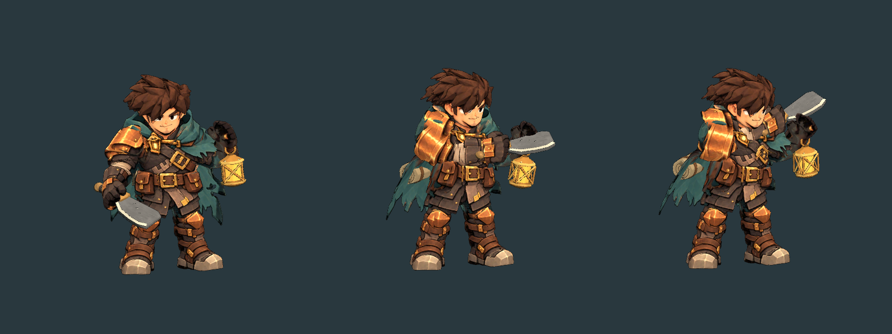
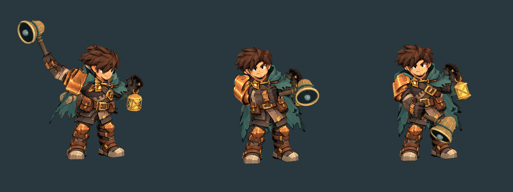
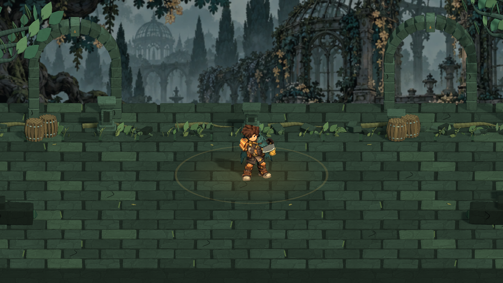
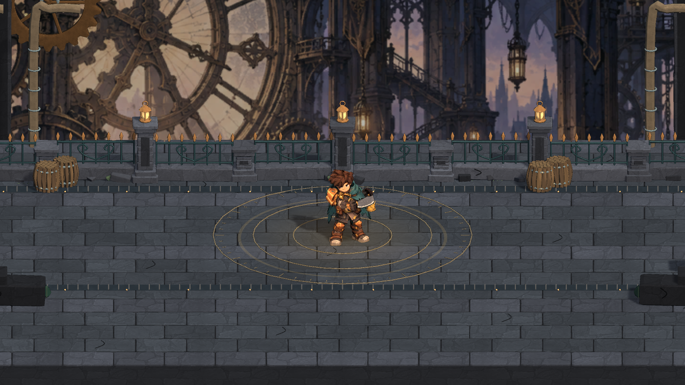

# v1.2 战斗与环境打磨

保留已确认的 Keeper 人物造型。本轮改动针对实际操作时的动作、接触、受击、危险区和战斗信息；下列图均为 Unity 实际网格渲染，不是概念设计稿。

## 动作与接触

三段弯刀分别为横斩、上挑、重斩；重锤有抬举蓄势、压身击打与较长回收；灯杖抬起后指向目标施法。`CombatMotion` 把接触姿势固定在模拟的 windup 边界，动作进程包含加速出手和回收。重锤蓄满后保持抬举姿势进入挥击，不会先落回待机；左右朝向的待机锤头和杖头保持在躯干轮廓外。轻攻击在收招末段允许提前 160 ms 输入；技能和闪避保留既有缓冲。

模型合批曾把武器烘进前臂，导致 Weapon 节点旋转与真正绘制的刀锤不一致。现在将 Weapon 保留为独立活动节点，并通过“节点下存在启用的渲染网格”断言和三姿势取图复查。修正前后不是只改特效参数。

接触反馈由短促高亮、带方向的碎片、受击姿态、平滑减速的击退、短暂停顿和轻微镜头回弹组成。普通斩、第三击、重锤和魔法有不同强度。空挥不制造命中震动。刀光跟随真实刀刃采样，重锤使用接地冲击，灯杖使用实际杖头的施法闪光。敌人死亡保留短暂倒地与渐隐，换波和奖励阶段也能正常收尾。

脚下阴影独立于跳跃角色，保持落在地面。危险区外轮廓对应实际圆形或矩形伤害范围，内部计时线推进到边界时触发攻击。受击数值按目标合并，破势和精准格挡有独立提示。

## 区域与界面

旧桥加入石材嵌线、排水槽与铁篦；庭院使用错动的石板、缝中苔藓、蕨类和落叶；钟楼使用石板、黄铜刻度和检修槽。装饰高度和位置避免暗示战斗区内不存在的阻挡，区域光照与背景微粒也分别调整。

HUD 将武器、蓄力/锋意/星能、武器技、灯油分成紧凑区块；技能冷却与资源有连续读数和进度条。玩家与首领血条保留短暂的伤害残量，使单次命中造成的损失可见。

## 与参考作的对照

本轮重新检查了已留存的《失落城堡 2》官方截图与连续画面，来源见 [研究与视觉对照](research/VISUAL-REVIEW.md)。对照重点是正常游戏尺度的轮廓、动作预兆、接触方向、反馈持续时间和战斗地面留白。采用这些原则，不移用原作美术资产，也不声称使用其内部帧数。

本轮解决了共用摆臂、武器节点无效、受击材质未响应、瞬移击退、死亡消失和区域地面一致等具体问题。与原作相比，当前仍是小规模三维课程游戏：场景布局与敌人动作库较少，区域交互主要通过菜单完成；不以“已达到商业游戏同等完成度”作为未经证明的结论。

## 测试入口

- `Tools/build.sh polish`（`CombatPolishReview.Validate`）：规则、战斗专项、新增反馈与缓冲、骨骼姿势、特效生命周期及模型资源。
- `Tools/build.sh smoke`：实际 Unity Play Mode 的三武器完整流程、菜单指针、保存、升级与自然失败。
- 最终 Mac / WebGL 构建另以真实键鼠操作游玩；结果见 [当前 QA](QA.md)。

测试全程静音。新合成的挥击、撞击和金属共鸣音效只验证样本有限、峰值和直流偏置，没有将未进行的听音评价写成通过。
