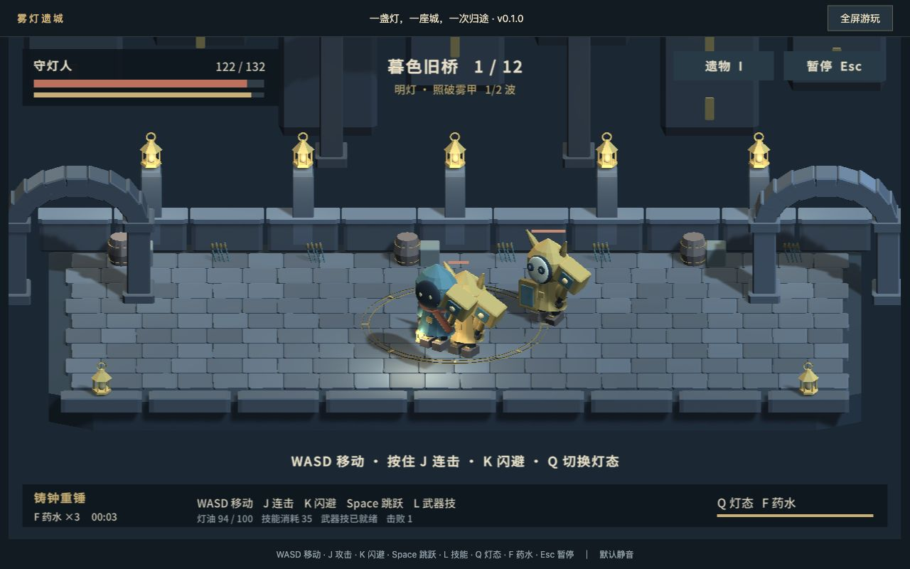

# 失落城堡 2 实机质感对照

参照图来自 Hunter Studio 的 Steam 商店实机截图，版权属于原作者；这里只引用公开图片地址用于研究。雾灯遗城图片为项目 v0.1.0 实际截图。图片本身不是新版制作成果。

## 当前原型的问题

角色与敌人聚在一起时，面具、躯干和四肢缺少清楚的区分。场景几乎由一块矩形地面、重复栏杆与重复灯柱组成，远处没有完整空间。地砖细节多，但环境叙事少。人物像摆件，静态画面看不出正在完成哪一段攻击。

这张图能证明功能在运行，也直接暴露了美术和动作的不足。不能用标题插画替代它来证明游戏品质。

## 角色和动作应该读得出来

先看脸、头发、手部、武器和敌人轮廓，再看地面的留白。刀光是有方向的弧线；人物的姿势参与动作表达。箱桶、栅栏和植物有大小变化，集中在场地边缘，不抢占主要战斗区域。

我们需要在正常游戏距离做到这种清楚的形状关系。建模细节先用于帽檐、脸、肩部、手套、握持与衣摆，再考虑小装饰。

## 场景需要真实的层次

前方深色植物构成近景，角色与可走地面处于中间，树干和更暗的树林形成后方空间。道路不靠整齐的地砖网格定义，而靠土地、植被、石块和边缘变化组织。

重做旧城桥时，对应的是近处断栏与堤岸、中间不规则桥面、后方城墙和远处雾城。即使没有敌人，也应能看出桥属于一座城市。

## 首领必须有自己的身体结构

巨大的躯干、头部、手臂和武器首先构成首领身份，普通角色围绕它组织空间。首领的体型和攻击器官决定动作；地面提示辅助阅读，不能代替身体预兆。

现版三个放大人形共用随机圆圈或横条的做法需要重做。守桥者、植物首领和钟楼首领应具有不同骨架或部件结构，以及与身体相符的攻击。

## 不同区域要有不同的物件语言

荒漠不仅变成黄色。沙地、巨型残骸、尖锐碎片、枯朽材料和远景共同建立区域身份。大的形体负责气氛，小道具提供生活或破坏痕迹。

雾庭和机械钟楼也要有各自的主物件、边界、地表与远景，不能把同一张房间替换一组颜色。

## 营地也是作品的一部分

设施、NPC、交互标志和火光使准备阶段成为世界的一部分。玩家能看见“在这里做什么”，也能通过空间记住设施。

我们的永久成长可以从菜单进一步落实到修灯台、锻造处与出发门。交互信息要清晰，但不把所有文字一直堆在战斗画面上。

完整机制与验收依据见 [游戏调研](LOST-CASTLE-2.md)。公开媒体来源见 [Steam 商店](https://store.steampowered.com/app/2445690/Lost_Castle_2/) 和 [来源索引](source-index.json)。
